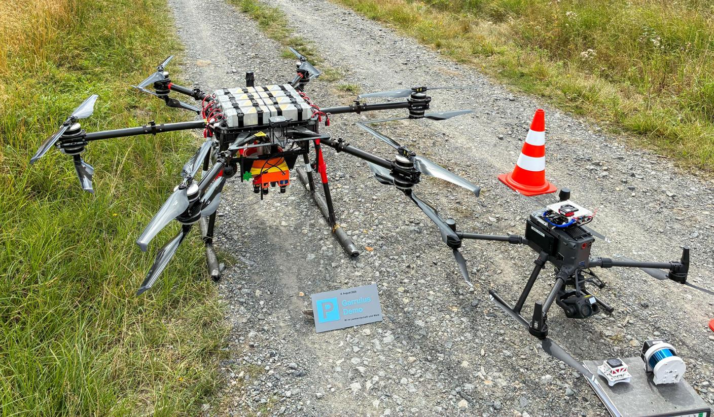

__Statt Setzlinge zu pflanzen, setzt das Projekt Garrulus auf Saatgutkapseln. KI errechnet zuvor die besten Stellen für eine möglichst erfolgreiche Keimung. Auf einer Versuchsfläche im Arnsberger Wald wurde der komplette Ablauf bereits erfolgreich getestet.__

Hirschberg – Könnten die Kalamitätsflächen im Warsteiner Wald bald mit Drohnen aufgeforstet werden? Wenn es nach Professor Alexander Asteroth und seinem Projektteam der Hochschule Bonn-Rhein-Sieg geht, dann schon. Sie stellten am Donnerstagvormittag in einem Waldstück im Arnsberger Wald unweit von Hirschberg ihr Forschungsprojekt „Garrulus“ (Anm. d. Red.: Fachbegriff für Eichelhäher) vor. Die Projektverantwortlichen und die Vizepräsidentin für Internationales und Digitalisierung der Hochschule, Professor Teena Hassan, präsentierten NRW-Landwirtschaftsministerin Silke Gorißen, dem heimischen Landtagsabgeordneten Jörg Blöming, Bürgermeister Maximilian Spinnrath sowie Vertretern des Landesbetriebs Wald und Holz die Drohnentechnik mit KI vor Ort.

[Zum Beitrag](https://www.soester-anzeiger.de/lokales/warstein/aufforstung-aus-der-luft-forscher-testen-ki-drohnen-fuer-den-wald-der-zukunft-94432473.html)
